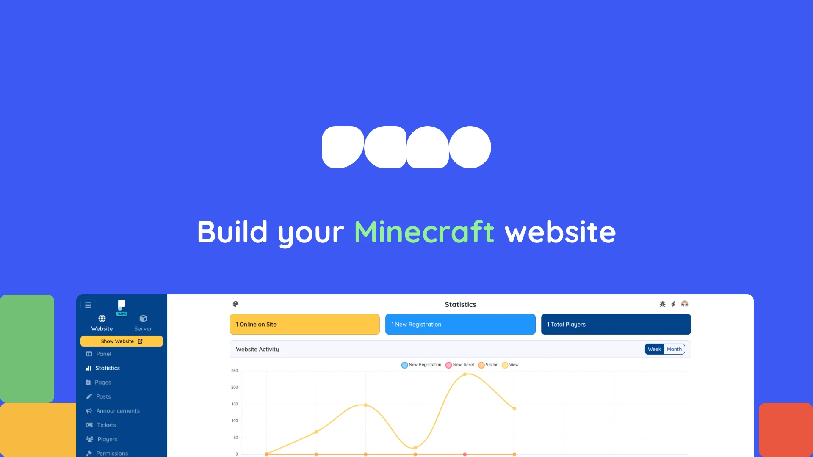

<h1 align="center">Pano MC Plugin</h1>

<h3 align="center">Connect your Minecraft server to Pano</h3>

<p align="center">
  The in-game plugin for <a href="https://github.com/PanoMC/pano">Pano</a>, the open-source website and panel for Minecraft servers.<br>
  Install it once, connect it from your Pano panel, and your server and website work together.
</p>

<p align="center">
  <a href="https://demo.panomc.com"></a>
  <a href="https://panomc.com"></a>
</p>

<p align="center">
  <a href="https://panomc.com/downloads"><b>Download</b></a> ·
  <a href="https://panomc.com/docs"><b>Docs</b></a> ·
  <a href="https://panomc.com/discord"><b>Discord</b></a>
</p>

<p align="center">
  <a href="https://github.com/PanoMC/pano-mc-plugin/releases/latest"></a>
  <a href="https://panomc.com/discord"></a>
  <a href="https://github.com/PanoMC/pano-mc-plugin/blob/HEAD/LICENSE"></a>
</p>

<p align="center">
  
</p>

---

<h2 align="center">What it does</h2>

<table>
  <tr>
    <td width="33%" valign="top">
      <h3>Live on your website</h3>
      Online players and server status show up on your Pano website as they happen.
    </td>
    <td width="33%" valign="top">
      <h3>Linked accounts</h3>
      Players link their game account to their website account with <code>/link</code>.
    </td>
    <td width="33%" valign="top">
      <h3>Managed from the panel</h3>
      Console, commands, players, performance, files and backups, right in your Pano panel.
    </td>
  </tr>
</table>

Works alongside LuckPerms, AuthMe and LimboAuth when you have them installed.

---

<h2 align="center">Supported servers</h2>

| Platform | File | Java |
|---|---|---|
| Paper, Spigot, Folia | `pano-spigot-<version>.jar` → `plugins/` | 11+ |
| BungeeCord | `pano-bungeecord-<version>.jar` → `plugins/` | 11+ |
| Velocity | `pano-velocity-<version>.jar` → `plugins/` | 17+ |
| Fabric (Minecraft 26.1+, needs Fabric API) | `pano-fabric-<version>.jar` → `mods/` | 25+ |

---

<h2 align="center">Get started</h2>

1. **Download** the file for your server from [panomc.com/downloads](https://panomc.com/downloads) or the [latest release](https://github.com/PanoMC/pano-mc-plugin/releases/latest).
2. **Install** it: put it in your server's `plugins/` folder (`mods/` on Fabric) and restart the server.
3. **Connect** it: in your Pano panel, open **Connect Server**, copy the command it shows and run it in your server console or in game:
   ```
   /pano connect <platform-address> <platform-code>
   ```
4. **Confirm**: the connection request appears as a notification in your panel. Accept it and you're done.

Check the link any time with `/pano status`, or remove it with `/pano disconnect`.

Don't have Pano yet? Get the platform at [**PanoMC/pano**](https://github.com/PanoMC/pano).

---

<details>
<summary><b>For developers</b></summary>

<br>

Kotlin + Gradle. Use JDK 17 or newer to run Gradle (the Fabric module builds with a Java 25 toolchain).

```bash
./gradlew build             # build every platform jar
./gradlew :Spigot:build     # one platform: :Spigot, :Bungeecord, :Velocity, :Fabric
./gradlew buildDev          # development build
./gradlew :Spigot:check     # Spigot tests, including AuthMe compatibility tests
```

Jars end up in `<Platform>/build/libs/`. Commits follow [Conventional Commits](https://www.conventionalcommits.org/); releases are automated.

</details>

---

<p align="center">
  Made with 💙 for Minecraft communities · Licensed under MIT
</p>
